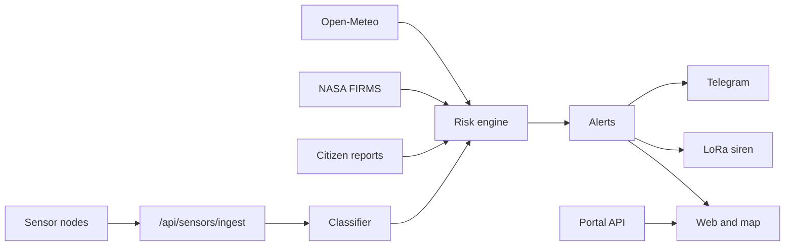

# Жайлоо — JailoApp

Early warning and a village market for mountain communities in Kyrgyzstan.

Mudflows, floods, avalanches and fires reach a village before a phone call does. **JailoApp** (Tabiyat Shield) watches sensor nodes, weather and satellite hotspots, then tells people what to do and how long they have. The same app is the village market: milk, kymyz, honey and livestock, sold directly, with **no online payments**.

Built for the SolarPunk hackathon in Bishkek. The interface is Kyrgyz by default, with Russian beside it, and the type is large enough to read outdoors.

## Features

**Early warning.** Acoustic and vibration nodes post readings to the API. A classifier labels vibration as noise, a vehicle, an earthquake or a mudflow. The risk engine scores each hazard from 0 to 100. High alerts notify people nearby. Critical alerts also queue a LoRa siren command. A mudflow alert includes an arrival time: distance along the nodes, times 1.3, divided by the speed measured between them (20 km/h assumed when only one node has fired).

**Outside the village.** NASA FIRMS hotspots and Open-Meteo weather feed the same engine. Anyone logged in can report a mudflow, rockfall, avalanche or fire from the map.

**Safety map.** Evacuation routes, shelters, the user’s home pin, and an “I’m safe” check-in. The home screen can read the current status aloud (Web Speech API).

**Market.** Listings with a photo, orders, chat, and reviews. The seller’s phone number appears only after they accept the order.

**Languages.** Kyrgyz (`ky`) and Russian (`ru`) on every screen.

## How it fits together



## Tech stack

| Layer | Choice |
|---|---|
| API | Django, Django REST framework, SimpleJWT, drf-spectacular |
| Database | SQLite locally. PostgreSQL when `DATABASE_URL` or `DB_NAME` is set |
| Bot | Telegram long-polling for one-time login codes |
| Web | Vite, React 19, Tailwind CSS v4, React Router, Framer Motion |
| Languages | Kyrgyz and Russian dictionaries in `src/lib/i18n.jsx` |

## Project structure

```
jailoapp/
├── src/                  React app
│   ├── pages/            One screen per route
│   ├── components/       Layout, icons, map art, shared UI
│   ├── lib/              API client, auth, i18n, speech, portal polling
│   └── index.css         Green and amber design tokens
├── public/               Favicon and icons
├── backend/
│   ├── apps/accounts/    Phone login, JWT, profile, watched places
│   ├── apps/geo/         Villages, shelters, routes, contacts
│   ├── apps/sensors/     Nodes, ingest, vibration classifier
│   ├── apps/risk/        Weather, FIRMS, risk scores
│   ├── apps/alerts/      Alerts, “I’m safe”, siren queue
│   ├── apps/reports/     Citizen hazard reports
│   ├── apps/market/      Listings, orders, chat, reviews
│   ├── apps/portal/      Home, map and config payloads for the UI
│   ├── apps/telegrambot/ Telegram bot
│   ├── apps/common/      Shared geo, messages, demo seed
│   └── config/           Settings and URL routing
├── Dockerfile            Production image: built UI served by Django
└── START.md              Short local run notes
```

## Quick start

Two terminals. The login code is shown on screen while `DEBUG=True`.

**Windows**

```bat
cd backend
python -m venv .venv
.venv\Scripts\activate
pip install -r requirements.txt
copy .env.example .env
python manage.py migrate
python manage.py seed_demo
python manage.py runserver 8000
```

```bat
npm install
npm run dev
```

**Mac / Linux**

```bash
cd backend
python3 -m venv .venv
source .venv/bin/activate
pip install -r requirements.txt
cp .env.example .env
python manage.py migrate
python manage.py seed_demo
python manage.py runserver 8000
```

```bash
npm install
npm run dev
```

Open http://localhost:5173. The dev server proxies `/api` and `/media` to port 8000.

### Environment

Copy `backend/.env.example`. Never commit `.env`.

| Variable | Role |
|---|---|
| `SECRET_KEY` | Django secret |
| `DEBUG` | `True` returns the login code in the API so the demo works without Telegram |
| `ALLOWED_HOSTS` | Hosts allowed to call Django |
| `CORS_ALLOWED_ORIGINS` | Browser origins allowed to call the API |
| `TELEGRAM_BOT_TOKEN` | Bot token from @BotFather. Empty disables sending |
| `NASA_FIRMS_MAP_KEY` | Free map key from NASA FIRMS. Empty skips hotspot fetch |
| `NASA_FIRMS_SOURCE` | FIRMS product, default `VIIRS_SNPP_NRT` |
| `DB_NAME` and related `DB_*` | Optional Postgres. Empty uses SQLite |
| `DATABASE_URL` | Postgres URL, used by the Docker / Railway setup |

Optional tuning (`FIRMS_BBOX`, `ALERT_RADIUS_KM`, `ALERT_CLEAR_MINUTES`, `PATH_FACTOR`, `MUDFLOW_ASSUMED_SPEED_KMH`, `OTP_EXPOSE_IN_DEBUG`) is commented in `.env.example`.

### Demo accounts

The code appears under the phone field.

| Role | Phone |
|---|---|
| Rescuer | +996700000002 |
| Villager | +996700000003 |
| Buyer | +996700000004 |

### Live mudflow demo

From `backend/`, with the API running:

```bash
python manage.py simulate_mudflow --reset
python scripts/simulate_node.py mudflow --nodes ak-tash-n1,ak-tash-n2 --gap 20
python scripts/simulate_node.py fire --nodes ak-tash-fire
```

`simulate_mudflow` writes the alert in the database. `simulate_node.py` sends real HTTP, the way a sensor would. Two nodes in sequence raise a critical mudflow with an ETA.

Background loops, optional:

```bash
python manage.py run_worker    # weather, FIRMS, risk engine
python manage.py run_bot       # Telegram bot
```

## 60-second walkthrough

1. Open Home. The valley is calm.
2. Log in as the rescuer (+996700000002). Profile → **Send alert**, mudflow, critical.
3. Home, the map and `/alert` turn red. The countdown is the time until the flow arrives.
4. Open the map. Show the path to the school shelter.
5. On the alert page, tap **I’m safe**.
6. Log in as the buyer (+996700000004). Order honey or kymyz.
7. Accept the order as the seller. The phone number appears only after that accept.
8. Profile → **Clear alerts**. The village goes calm again.

## API

Interactive docs: http://localhost:8000/api/docs/ while the backend is running.

| Area | Main routes |
|---|---|
| Auth | `POST /api/auth/otp/request/`, `/otp/verify/`, `/token/refresh/`, `GET/PATCH /me/` |
| Portal | `GET /api/portal/config/`, `/home/`, `/map/` |
| Geo | `GET /api/geo/villages/`, `/evacuation-points/` |
| Sensors | `POST /api/sensors/ingest/` with header `X-Device-Key` |
| Risk | `GET /api/risk/overview/`, `/villages/<id>/`, `/hotspots/` |
| Alerts | `GET /api/alerts/`, `/active/`, `POST /simulate/`, `/<id>/resolve/`, `/<id>/safe/` |
| Siren | `GET /api/alerts/siren/pending/`, `POST /siren/<id>/ack/` |
| Reports | `POST /api/reports/` |
| Market | `/api/market/categories/`, `/listings/`, `/orders/`, `/threads/` |
| Health | `GET /api/health/` |

## Screens

| Route | What it does |
|---|---|
| `/` | Village status, weather, roads, shelters, a link into the market. Reads the status aloud. |
| `/map` | Safe and danger zones, shelters, evacuation route, home pin, hazard report. |
| `/market` | Listings. Order from here. Phone stays hidden until the seller accepts. |
| `/sell` | Photo, name, amount, unit, price, category. Publishes a listing. |
| `/alert` | Countdown, what to do now, route to shelter, “I’m safe”, call 112. |
| `/help` | What to do for each hazard, and village phone numbers. |
| `/login` | Phone and one-time code. Demo accounts are on the page. |
| `/orders` | Buyer and seller tabs. Accept, complete, review. |
| `/chats` | Conversations with a seller. Messages refresh about every 4 seconds. |
| `/me` | Name, village, home pin, language, listings. Rescuers can send or clear a test alert. |

## Known limitations

- Village coordinates and shelter shapes are approximate demo data.
- Phone numbers in the seed data are placeholders.
- Kyrgyz speech falls back to a Russian voice in most browsers. The Kyrgyz copy still needs a native speaker’s review.
- Distance uses haversine in SQLite, not PostGIS.
- There are no payments. That is intentional: the deal happens in the village, and the phone is shared only after the seller accepts.

## Roadmap

- Calibrate the vibration classifier with real field recordings.
- Replace the demo map geometry with surveyed channels and shelters.
- Native Kyrgyz voice, and a reviewed Kyrgyz text pass.
- A persistent siren gateway and a worker that runs weather and FIRMS on a schedule in production.

## Credits

SolarPunk hackathon, Bishkek. JailoApp is the village face of Tabiyat Shield: sensors and satellite risk on one side, the local market on the other.
